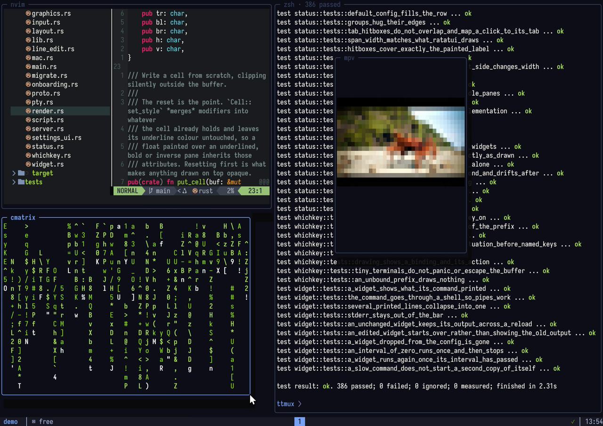

<h1 align="center">ttmux</h1>

<p align="center"><em>A modern multiplexer alternative.</em></p>

<p align="center">
  <a href="https://github.com/statico/ttmux/actions/workflows/ci.yml"></a>
  <a href="https://github.com/statico/ttmux/releases"></a>
  <a href="LICENSE"></a>
  
  
</p>

<p align="center"><picture><source srcset="docs/demo.avif" type="image/avif"></picture></p>

ttmux runs many terminals in one window, like tmux or screen. It adds
floating panes, real mouse support, curved borders, and a settings screen
that you open inside the app.

## Install

With Homebrew, on macOS or Linux:

```
brew install statico/tap/ttmux
```

Or build it with Cargo, which needs Rust 1.82 or later:

```
cargo install ttmux
```

To build the latest code on `main`, use `cargo install --git https://github.com/statico/ttmux`.

On Arch Linux, build the package from the PKGBUILD in this repository:

```
git clone https://github.com/statico/ttmux
cd ttmux/packaging/arch
makepkg -si
```

If you use [paru](https://github.com/Morganamilo/paru), you can add this
repository as a PKGBUILD repository. Add these lines to
`~/.config/paru/paru.conf`:

```
[ttmux]
Url = https://github.com/statico/ttmux
Path = packaging/arch
```

Then install it with `paru -Sy ttmux`. paru then gets each new release when
you update your system.

Then start it:

```
ttmux
```

Prebuilt binaries for macOS and Linux are also on the
[releases page](https://github.com/statico/ttmux/releases).

## Why

tmux works well, and many people know its keys. But a new tmux install
needs a `.tmux.conf` file and plugins such as
[tmux-sensible](https://github.com/tmux-plugins/tmux-sensible) before it is
comfortable to use. ttmux has those defaults from the start.

| | tmux, by default | ttmux |
|---|---|---|
| Escape key | a delay after <kbd>esc</kbd> (500ms before 3.5) | no delay, so vim leaves insert mode at once |
| Scrollback | 2,000 lines | 10,000 lines |
| Mouse | off | on: click, drag, resize, and wheel |
| Color | truecolor and undercurl need `terminal-overrides` | truecolor and undercurl |
| Focus events | off | on |
| Clipboard | ignores OSC 52 from programs | copies to your clipboard, or set `clipboard = false` |
| Modern keys | `extended-keys` off, so shift+enter is lost | kitty keyboard and modifyOtherKeys |
| Images | sixel if built in, the rest need `allow-passthrough` | kitty, iTerm2, and sixel, even `mpv` video, and nothing but images |
| Config | `.tmux.conf`, `source-file` by hand | TOML, reload with the prefix and <kbd>r</kbd>, or a settings screen |
| Help with keys | a list behind the prefix and `?` | a which-key popup and a command palette |
| Layout | tiling | tiling or free-floating, drag and drop |
| Agents | — | a per-pane busy, needs-you, or done mark |

## Keys

When you start ttmux for the first time, it asks which keymap you want:
Modern, tmux, or screen. To change the keymap later, use the settings screen
or `general.keys-preset`. To change one key, add it under `[keys]`.

<details>
<summary>Keys for each keymap</summary>

| Action | Modern (`ctrl+t`) | tmux (`ctrl+b`) | screen (`ctrl+a`) |
|---|---|---|---|
| Split right | `v` or `%` | `%` | `\|` |
| Split down | `s` | `"` | `S` |
| Move the focus | `h` `j` `k` `l` | arrows | `tab` |
| Resize the pane | `H` `J` `K` `L` | | |
| Zoom the pane | `z` or `o` | `z` | |
| Float one pane | `f` | | |
| Next layout | `space` | `space` | |
| New, next, previous tab | `c` `n` `p` | `c` `n` `p` | `c` `n` `p` |
| Last tab | `ctrl+t` | | |
| Go to tab 1 to 9 | `1`–`9` | `1`–`9` | `1`–`9` |
| Move the tab left or right | `<` `>` | | |
| Break the pane into a tab | `!` | `!` | |
| Join the pane into a tab | `@` | | |
| Rename the tab, the pane | `A`, `a` | `,`, `.` | `A`, `.` |
| Scroll back, or copy mode | `[` or `esc` | `[` | `esc` |
| Paste what copy mode copied | `]` | `]` | `]` |
| Close the pane | `x` or `q` | `x` | `K` |
| Close the tab | `&` | `&` | |
| Command line | `:` | `:` | `:` |
| Command palette | `;` | | |
| Jump to a tab or pane | `"` | `w` or `s` | `"` |
| Send the prefix | `t` | `ctrl+b` | `a` |
| Settings | `,` | | |
| Help | `?` | `?` | `?` |
| Detach | `d` | `d` | `d` |
| Quit ttmux | `Q` | | |

Every keymap also has these, with no prefix:

| Key | Action |
|---|---|
| <kbd>alt+arrows</kbd> | Move the focus |
| <kbd>alt+shift+arrows</kbd> | Resize the pane |
| <kbd>ctrl+alt+right</kbd> / <kbd>down</kbd> | Split right or down |
| <kbd>ctrl+alt+w</kbd> | Close the pane |
| <kbd>ctrl+alt+f</kbd> | Switch between tiling and free mode |
| <kbd>ctrl+alt+z</kbd> | Zoom the pane |
| <kbd>ctrl+alt+t</kbd> | New tab |
| <kbd>ctrl+1</kbd>–<kbd>9</kbd> | Go to tab 1 to 9 (see `tab-number-keys`) |
| <kbd>ctrl+alt+p</kbd> | Command palette |
| <kbd>ctrl+'</kbd> | Jump to a tab or pane |
| <kbd>ctrl+alt+,</kbd> | Settings |
| <kbd>ctrl+alt+n</kbd> | Go to the next pane that wants you |
| <kbd>shift+pageup</kbd> / <kbd>pagedown</kbd> | Scroll back and forward |

</details>

Press the prefix and <kbd>?</kbd> in the app for the full list.

Copy mode, as in tmux, is off by default. Programs such as coding agents
do their own copy, and they need the mouse drag for it. To use copy mode,
set `general.copy-mode = true`. Then the scroll back key opens it:

- Move with <kbd>h</kbd> <kbd>j</kbd> <kbd>k</kbd> <kbd>l</kbd>, or by word
  with <kbd>w</kbd> <kbd>b</kbd> <kbd>e</kbd>.
- Press <kbd>v</kbd> to start a selection, and <kbd>y</kbd> to copy it.
- Press <kbd>q</kbd> to leave.

A mouse drag over a pane also copies. The copied text goes to your
clipboard and to a paste buffer. The prefix and <kbd>]</kbd> type the
paste buffer into the pane.

<kbd>ctrl+'</kbd> lists every tab and every pane in it, with each
pane's title and folder. Type a few letters of any of them, then press
<kbd>Enter</kbd> to go there. The letters only need to come in order, so
`apsrv` finds `api` / `server`. This key needs a terminal with the kitty
keyboard protocol. In other terminals, use the prefix and the key in the
table above.

After you press the prefix, a popup shows the keys that can come next, as
which-key does in neovim. To disable the popup, set
`general.which-key = false`.

The prefix and <kbd>:</kbd> open a command line for the scripting
commands below. <kbd>Tab</kbd> completes a command or a flag. The row above
the command line shows the usage of the current command.

A program can set a title with an escape sequence. This title goes on the
pane, not on the tab, and it never replaces a name that you set. A tab shows
the title of its pane only when the tab has one pane.

Every text field takes the readline keys, including <kbd>ctrl+a</kbd>,
<kbd>ctrl+e</kbd>, <kbd>ctrl+w</kbd>, <kbd>ctrl+k</kbd>, <kbd>ctrl+u</kbd>,
<kbd>ctrl+y</kbd>, <kbd>alt+b</kbd>, and <kbd>alt+f</kbd>. In a list,
<kbd>ctrl+n</kbd> and <kbd>ctrl+p</kbd> move the selection, and
<kbd>ctrl+g</kbd> cancels.

## Free mode

<kbd>ctrl+alt+f</kbd> changes the grid of panes into floating windows.
Drag a title bar to move a pane. Drag a corner to resize it. Click a pane to
bring it to the front.

In tiling mode, drag the line between two panes to resize them. Drag a pane
by its title onto the side of another pane to move it there. Drag a tab
along the status bar to change the order of the tabs.

## Sessions

Sessions work as in tmux. The server keeps your panes alive after you
detach.

```
ttmux                       # attach to the default session, or start it
ttmux new -d -s work        # start a session in the background
ttmux attach -t work        # attach to a named session
ttmux ls                    # list the sessions
ttmux kill-session -t work  # stop one
ttmux upgrade               # move a session to a server started from here
```

<kbd>ctrl+t</kbd> <kbd>d</kbd> detaches.

`ttmux upgrade` moves a live session to a new server. The shells, jobs, and
screens stay. Add `-t work` for a named session. Use it for two things:

- **A new version.** Install the new build, then run `ttmux upgrade`. The
  session then runs on the new build.
- **The macOS keychain and permission prompts.** macOS ties them to the
  terminal that started the server. When that terminal quits, panes cannot
  unlock the keychain or show a permission prompt. To correct this, run
  `ttmux upgrade` in a terminal window that is not inside ttmux.
  `ttmux doctor` tells you if a session has this problem.

The scrollback comes back as plain text, and inline images are lost.

When a client attaches, new panes get its `SSH_AUTH_SOCK`, `DISPLAY`, and the
other variables in `general.update-environment`. If the client does not have
one of them, new panes do not get it either.

## Scripting

A program in a pane can control the session of that pane. The commands
have the same names and flags as in tmux, so most tmux scripts work without
a change.

<details>
<summary>The commands</summary>

```
ttmux send-keys -t %2 "make test" Enter   # type into a pane
ttmux split-window -h                     # split side by side, prints %2
ttmux capture-pane -t %2 -S -             # read a pane, scrollback and all
ttmux new-window                          # open a tab, prints its number
ttmux select-pane -t %2                   # or -L -R -U -D
ttmux list-panes                          # %2: [80x24] zsh (active)
ttmux list-windows                        # 1:build (2 panes) (active)
ttmux rename-window build                 # name a window
ttmux display-message "done"              # show text in the status bar
ttmux join-pane -s %3 -t 2                # move a pane into window 2
ttmux break-pane                          # and back out into its own
ttmux run toggle-zoom                     # any key-binding action
```

</details>

A target is a pane id from `list-panes`, or a window number that starts
at 1. If a command has no target, it acts on the pane that it runs in.
Outside ttmux, it acts on the focused pane. The command uses the session in
`$TTMUX_SESSION`, which ttmux sets in every pane. `ttmux --help` prints the
full list.

[API.md](API.md) is the full reference: every command, every flag, the exit
codes, and examples. `ttmux <command> --help` prints the help for one
command. `ttmux list-commands --json` prints the full API in a form that a
program can read.

## Config

The config file is `~/.config/ttmux/ttmux.toml`. ttmux writes it when you
first save in the settings screen. Every key in the file is also in the
settings screen. You can keep the file in version control and make changes
in the screen.

After you edit the file, press the prefix and <kbd>r</kbd> to reload it.
ttmux does not reload the file automatically. The widget commands in the
file run as your user, so a program that changes the file must not be able
to start them.

<details>
<summary>An example config</summary>

```toml
[general]
mouse = true
scrollback = 10000
free-mode = false
keys-preset = "vim"          # vim (Modern) | tmux | screen
tab-number-keys = "ctrl"     # ctrl | alt | ctrl-shift | off: modifier+1-9 goes to a tab
passthrough-images = true    # kitty, iTerm2, and sixel inline images
clipboard = true             # programs can copy with OSC 52
notifications = true         # programs can send OSC 9, 99, and 777
copy-mode = false            # tmux's copy mode and mouse-drag copy
remain-on-exit = false       # keep a pane after its program exits, for respawn-pane
update-environment = ["SSH_AUTH_SOCK", "DISPLAY"]  # taken from each client that attaches

[appearance]
border-style = "curved"      # curved | square | heavy | double | dashed | divider | none
border-focused = "#7aa2f7"
gap = 0

[status.footer]
enabled = true
left = ["session", "mode"]
center = ["tabs"]
right = ["agents", "time"]

[agents]
enabled = true
bell-on-attention = true
busy-spinner = "braille"   # none, braille, circle, line, dots

# Overrides on top of the preset. "none" unbinds a key, and "command"
# runs a scripting command each time the key is pressed.
[keys]
"ctrl+t v" = "split right"
"ctrl+t &" = "none"
"alt+3" = "command select-pane --where @slot=3"
```

</details>

## Custom widgets

A widget runs a shell command and shows the output in the status bar. Give
the widget a name under `[status.widgets]`. Then put that name in a row.

<details>
<summary>How widgets work</summary>

```toml
[status.footer]
enabled = true
right = ["disk", "time"]

[status.widgets.disk]
command = "df -h / | awk 'NR==2 {print $5}'"
interval = 60               # seconds between runs, 0 runs it once
```

The command runs with `sh -c`, so pipes, globs, and `~` work. ttmux shows
the first line of the output. ttmux also reads tmux markup such as
`#[fg=red,bold]`, so a script for tmux `status-right` works without a change.

A slow command does not stop the screen. The command runs in its own thread.
ttmux does not start a second copy while the first copy runs.

</details>

## Coding-agent alerts

A pane that runs a coding agent gets a mark: `◐` for busy, `●` for "needs
you", and `✓` for done. The status bar shows how many panes wait for you.
<kbd>ctrl+alt+n</kbd> goes to the next of these panes. ttmux finds the state
with text patterns under `[agents]`, so you can add patterns for any agent.

A program that reports its own status with
[OSC 7501](https://www.superlogical.com/rex/docs/build/program-status) does
not need patterns. `working` shows as busy, `blocked` and `error` show as
"needs you", and `done` shows as done.

The pane border also shows the progress and the message from the program,
for example `cargo · 40% compiling`. When the program is blocked, the border
shows the reason, for example `terraform · needs permission: apply plan?`.

The reports from the program replace the patterns. This continues until the
program clears its status, the terminal resets, or the shell shows its next
prompt.

## Terminals

ttmux is tested most with Ghostty and iTerm2. It works in any terminal
that has 24-bit color and SGR mouse reports. Examples are Alacritty, kitty,
WezTerm, and Terminal.app.

<details>
<summary>Ghostty and alt+arrows</summary>

Ghostty does not send `alt+left` and `alt+right` to ttmux. It uses these
keys to move by word, as readline does. To move the focus left and right
with these keys, remove the Ghostty bindings in the Ghostty config:

```
keybind = alt+left=unbind
keybind = alt+right=unbind
```

</details>

## Compatibility

ttmux supports these terminal features for programs in a pane:

- Truecolor, and undercurl, dotted, dashed and double underlines in color
  (SGR 38/48/58 and `4:x`)
- Emoji with skin tones, flags and ZWJ sequences as one wide cell
- Kitty keyboard protocol (flags 1 and 8) and xterm modifyOtherKeys, so
  shift+enter works
- Kitty graphics, iTerm2 inline images (OSC 1337) and sixel, including
  `mpv --vo=kitty` video
- Synchronized output (mode 2026), so redraws do not tear
- Focus events (mode 1004), bracketed paste (mode 2004), SGR mouse
  reporting (modes 1000, 1002, 1003, 1006), and a cursor shape per pane
  (DECSCUSR)
- Window titles (OSC 0, 1, 2)
- OSC 52 copy to your clipboard, and OSC 9, 99, and 777 notifications.
  You can disable each of them.
- [OSC 7501 program status](https://www.superlogical.com/rex/docs/build/program-status):
  a program that reports `working`, `blocked`, `done`, or `error` sets the
  agent mark of its pane. See [Coding-agent alerts](#coding-agent-alerts).
- Shell prompt marks (OSC 133 `A`), which clear the status of the last
  command
- Answers to cursor position and status (DSR 5, 6), device attributes (DA1,
  DA2), XTVERSION, window size (`CSI 18t`), mode (DECRQM), color (OSC 10,
  11) and XTGETTCAP queries, so fzf, neovim and fish do not stall
- Dark or light theme reports (`CSI ?996n`, mode 2031)
- Scrollback that keeps output scrolled under a fixed footer, as Claude
  Code and Codex draw, and `CSI 3J` to clear it
- Bracketed pastes that the pasted text cannot end early
- No accidental nesting: as in tmux, ttmux does not attach from inside a
  pane

## Platforms

macOS on Apple silicon and Intel, and Linux on x86_64 and aarch64. CI tests
macOS on both chips and Linux on x86_64. Each release has builds for all
four.

## Security

[SECURITY.md](SECURITY.md) describes the threat model, the hardening, how
ttmux compares with tmux, and how to report a vulnerability.

## Development

```
make check      # format, lint, and test, the same as CI
make help       # all the targets
```

MIT licensed.
